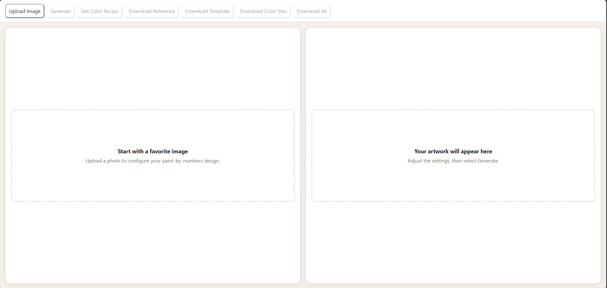
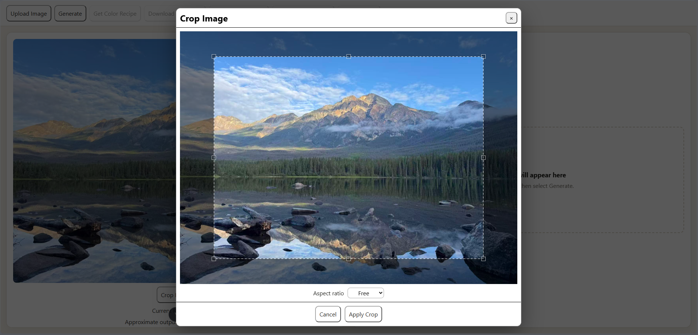
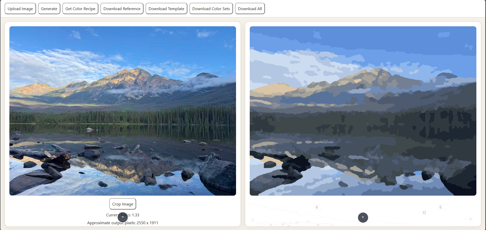
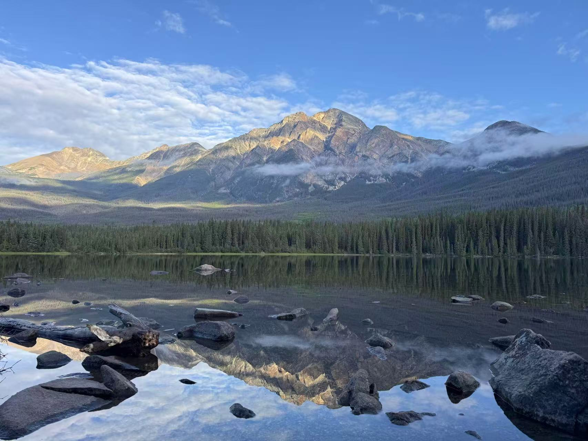
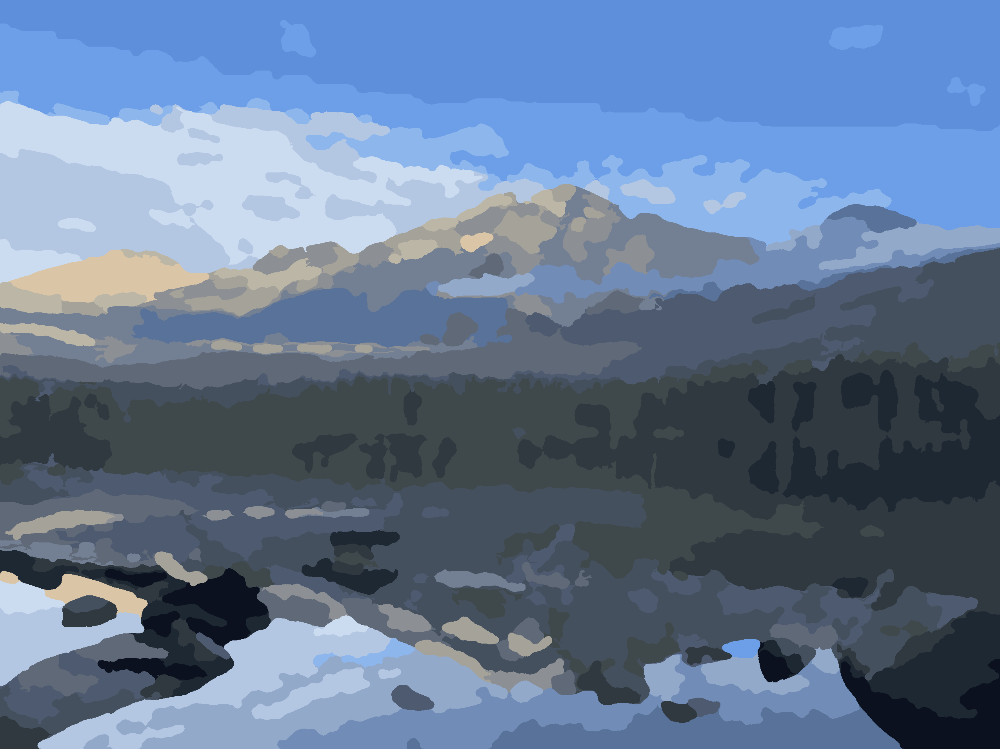
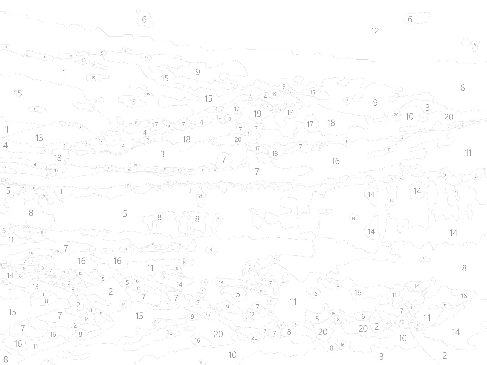
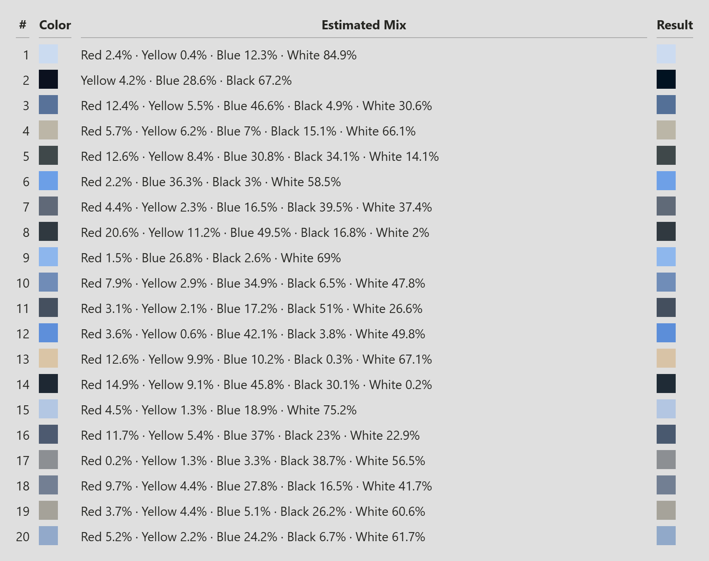

# Paint by Numbers

Turn your photos into personalized paint-by-numbers templates.

Paint by Numbers is a full-stack web application that simplifies an uploaded image into a limited color palette, outlines its regions, and labels them with matching color numbers. Download the template, color reference, and palette to use as a painting guide.

## Application Preview







Upload an image, adjust processing settings, and preview your painting guides.

## Example Results

### Input Image



### Generated Painting Guides

| Color Reference | Numbered Template |
|---|---|
|  |  |

### Color Key



## Features

- **Upload and crop images** — Supports PNG, JPEG, and WebP, with freeform and preset crop ratios.
- **Customize the palette** — Choose between 2 and 50 colors.
- **Adjust image simplification** — Control smoothing and small-region merging.
- **Configure output size** — Choose a paper preset or custom dimensions and adjust PPI.
- **Generate painting guides** — Create a numbered outline template, simplified color reference, and numbered color key.
- **Estimate paint mixtures** — Get suggested mixtures using red, yellow, blue, black, and white.
- **Download your results** — Save individual PNG files or download everything in a ZIP archive.

## How It Works

1. Upload an image and crop it to your preferred composition.
2. Choose the color count, smoothing, and merge settings.
3. Set the output dimensions and PPI.
4. Click **Generate** to create the template and color reference.
5. Optionally request paint-mixing recipes.
6. Download your painting guides.

The image-processing pipeline reduces the color palette, merges small and narrow areas, detects region boundaries, and places numbers within each region.

## Built With

**Frontend:** React, TypeScript, and Vite  
**Backend:** Python and FastAPI  
**Image processing:** Pillow, NumPy, OpenCV, and SciPy  
**Paint-mixing estimation:** Mixbox

## Run Locally

### Prerequisites

- Python with `pip` and `venv`
- Node.js and npm
- Windows, with the current font configuration

The backend currently uses the font at
`C:/Windows/Fonts/segoeuisl.ttf`. To run on another system, update
`NUMBER_FONT_PATH` in `backend/app/services/image_processor.py`
to an available TrueType font.

### Start the Backend

From the project root, run:

```powershell
cd backend
python -m venv .venv
.\.venv\Scripts\Activate.ps1
python -m pip install -r requirements.txt
python -m uvicorn app.main:app --reload
```

The API runs at http://127.0.0.1:8000. Interactive API documentation
is available at http://127.0.0.1:8000/docs.

### Start the Frontend

Open a second terminal in the project root:

```powershell
cd frontend
npm install
npm run dev
```

Open http://localhost:5173 in your browser.

The frontend connects to http://127.0.0.1:8000 by default.
To use another backend address, set `VITE_API_BASE_URL`
in `frontend/.env.local`.

## Project Structure

```text
PaintByNumbers/
├── frontend/             # React interface
│   └── src/
│       ├── api/          # Backend requests
│       └── components/   # Upload, crop, settings, and previews
├── backend/
│   ├── app/
│   │   ├── api/          # FastAPI endpoints
│   │   ├── models/       # Request schemas
│   │   └── services/     # Image processing and paint mixing
│   └── tests/
└── README.md
```

## Project Status

This project is under active development. Region merging and number
placement are still being refined, so complex images may produce
small or difficult-to-paint areas.

Paint-mixing recipes are estimates; results will vary with the paints
and pigments used.
